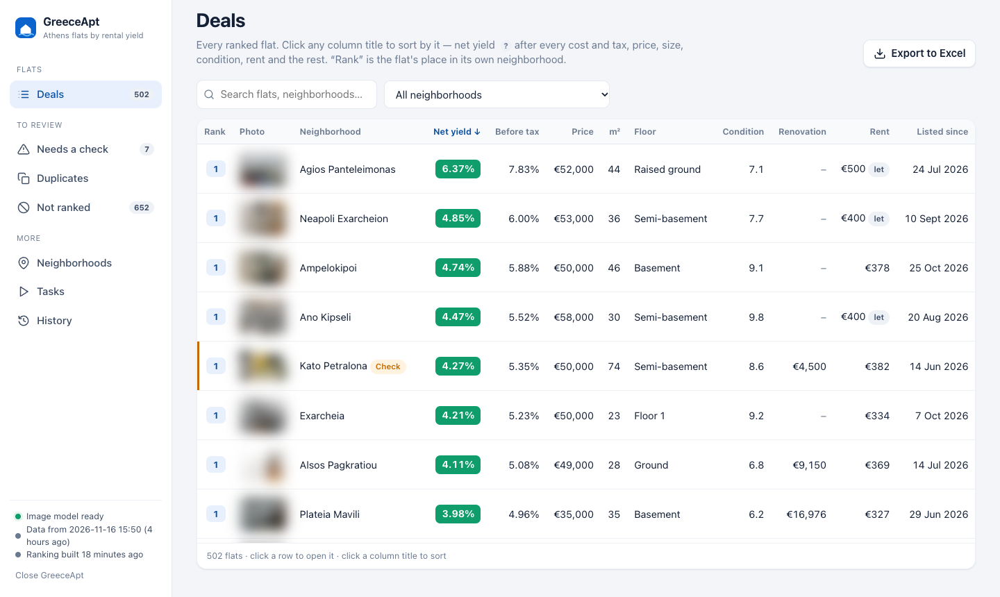
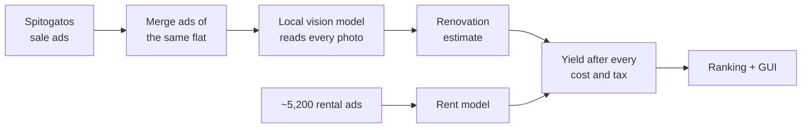
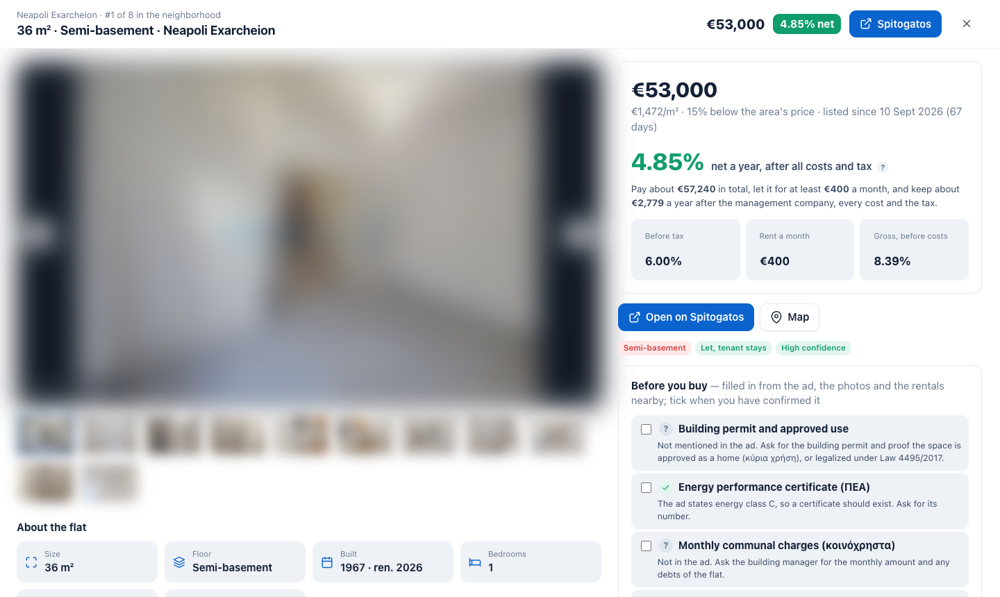
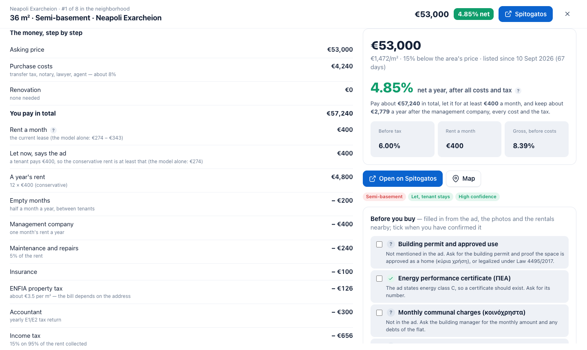

# GreeceApt

**Which small flat in central Athens actually pays?** GreeceApt collects every studio and
one-bedroom flat for sale between €30k and €70k, reads each flat's photos with a local vision
model, estimates the rent it would really let for, and ranks the flats by the yield left after
**every** cost and tax — renovation, vacancy, management, property tax, accountant and income tax.




<sub>Photos are blurred here: they belong to the advertising agencies.</sub>

## Why

Listing sites sort by price or by date. A cheap flat that needs a new kitchen and sits in a
semi-basement can be a worse investment than a dearer one that is ready to let — and the
asking rent in an ad is not what a tenant signs for. Answering "what will this flat earn?"
means pricing the renovation from the photos, predicting the signed rent from thousands of real
rentals, and subtracting everything an owner actually pays.

## How it works



1. **Collect** sale ads from Spitogatos' public JSON endpoints with an ordinary, self-identifying
   HTTP client; a refusal stops the run.
2. **Merge** the ads of one flat (several agencies, different watermarks) using perceptual
   photo hashes, price, area and location — so each flat is ranked once, at its cheapest ad.
3. **Read the photos** with Qwen3-VL running locally through Ollama. The model reports what it
   sees (kitchen age, wall condition, damage …); Python turns that into a reproducible score.
4. **Price the renovation** from the photos, and **predict the rent** with a model trained on
   real rental ads.
5. **Rank** flats by net yield inside each neighborhood, flag the ones to double-check, and
   show everything in a local web app.

The details and the reasoning behind each choice are in
**[docs/ARCHITECTURE.md](docs/ARCHITECTURE.md)**.

## Highlights

| | |
|---|---|
| **Rent model** | Ridge regression on log-rent with a nearest-rentals location term; **13.2 % MAPE** out of fold vs 20.9 % for a neighborhood €/m² baseline. Conservative rent from split-conformal 10th-percentile bounds per group (~90 % coverage). |
| **Vision, locally** | One local 4B vision model, chosen in a bake-off against an 8B one on a pairwise-labelled golden set. Evidence-based prompts, deterministic scoring, a content-addressed cache and a health guard that stops a bad run. |
| **Renovation engine** | Thresholds calibrated on 102 hand-labelled flats; costs continuous in the score; a separate kitchen/bathroom job priced from Greek market guides when one room is poor. Agrees with what ads say: "renovated" → 83 % none/paint, "needs renovation" → 93 % medium/full. |
| **Deduplication** | Watermark-resistant photo fingerprints, complete-linkage grouping, human review for ambiguous pairs, persistent flat IDs across runs. |
| **Honest numbers** | The ranked yield is after vacancy, management, maintenance, insurance, property tax, accountant and 15 % income tax, at the rent tenants *sign* for (asking × 0.9). A lease stated in the ad is used as the rent's floor. |
| **Reliability** | Atomic, integrity-checked publishing of the results database; locks so two updates never collide; backups before every update; ~680 offline tests. |





## Run it

Requirements: Python 3.11+, [Ollama](https://ollama.com) with the vision model, macOS or Linux.

```bash
python3 -m venv venv && source venv/bin/activate
pip install -r requirements.txt -r requirements-dev.txt && pip install -e .
ollama pull qwen3-vl:4b-instruct

python -m pytest              # ~680 tests, offline, ~30 s
./update                      # collect, read photos, rank (the first run takes hours)
./gui                         # open the app on 127.0.0.1
```

Other entry points:

```bash
./update check                          # what an update would change (reads search pages only)
python -m greeceapt.main --score-only   # re-rank from stored data in seconds
python -m greeceapt.rent train          # retrain the rent model
```

Everything runs on one machine; nothing is scheduled — an update happens only when it is
started.

## Project structure

```
src/greeceapt/
├── collect/      1. Spitogatos collector, floor resolution, photo fingerprints, merging ads
├── storage/      2. data paths, SQLite databases, neighborhood names
├── photos/       3. Layers 0–2: metadata filter, vision model on every flat, condition gate
├── vision/          the vision model client: image preparation, scoring, cache
├── rent/            rental ads → the rent model (train, refresh, validate)
├── scoring/      4. renovation, rent, costs and tax, ranking, checks
├── gui/             local web app (FastAPI + plain JS)
├── evaluation/      offline tools: vision-model bake-off, dedupe evaluation
├── main.py          the full pipeline
└── update.py        ./update: lock, backup, run, change report
tests/               offline tests and anonymised fixtures
docs/                architecture, model survey, source evaluation
```

## Data and ethics

- Built for personal investment research. The collector identifies itself, respects
  robots.txt, reads only public listing endpoints, makes no attempt to evade blocking and stops
  on the first refusal. A second source was dropped because its terms forbid automated
  collection.
- No scraped data is published: `data/` is git-ignored, and the test fixtures keep only the
  structured fields the code needs — no ad text, no photo links, no contact details.

## Limitations

- One city and one site; the rent model learns asking rents and corrects them with a single
  measured discount.
- Photos cannot show everything: a dim photo of an old kitchen can score well, and whether a
  basement is legally a home cannot be read from an ad — the app lists these as checks for a
  visit.
- Not financial advice.

## License

[MIT](LICENSE)
