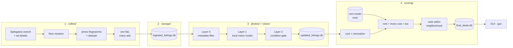

# GreeceApt — architecture and design decisions

This document explains how a sale advertisement becomes a ranked flat, and why each step works
the way it does. Numbers are from the November 2026 data unless stated otherwise.

- [1. Pipeline](#1-pipeline)
- [2. Collecting](#2-collecting)
- [3. From advertisements to flats](#3-from-advertisements-to-flats)
- [4. Reading the photos](#4-reading-the-photos)
- [5. The rent model](#5-the-rent-model)
- [6. Cost and renovation](#6-cost-and-renovation)
- [7. Yield and ranking](#7-yield-and-ranking)
- [8. Checks before you buy](#8-checks-before-you-buy)
- [9. Updates, storage and the GUI](#9-updates-storage-and-the-gui)
- [10. How the results were validated](#10-how-the-results-were-validated)
- [11. Testing](#11-testing)

---

## 1. Pipeline



`python -m greeceapt.main` runs the four stages; `./update` wraps them with a lock, a backup
and a change report; `python -m greeceapt.main --score-only` re-runs stage 4 alone (seconds).

| Stage | Package | Output |
|---|---|---|
| 1 Collect + merge | `collect/` | `data/listings.json` (one record per physical flat) |
| 2 Store | `storage/ingest.py` | `data/ingested_listings.db` |
| 3 Photos | `photos/`, `vision/` | `data/updated_listings.db` (with a condition score per flat) |
| 4 Rank | `scoring/` (+ `rent/`) | `data/final_deals.db`, published atomically |

---

## 2. Collecting

`collect/spitogatos/scrape.py` reads Spitogatos' public JSON search and detail endpoints.

- **An ordinary client.** Plain `requests` with a User-Agent that names the project. No browser,
  no browser impersonation, no bot-detection tokens, no proxies. robots.txt is respected.
- **A refusal stops everything.** HTTP 403/405/429 stops the collector (exit code 3), the merge
  does not run, and `./update` records the run as `blocked`. Nothing is retried.
- **Cheap sweeps.** Every search page is read; an ad already stored costs no further request
  (price, dates and `last_seen_at` come from the search row). Details are fetched only for new
  ads and ads whose photo set changed.
- **Trusted sweeps.** An ad the sweep did not see is marked `gone_since` only when the sweep is
  trusted: it reached the last page, saw ≥ 98 % of the site's own result count and ≥ 70 % of the
  previous trusted sweep. An untrusted sweep still records new ads and price changes.
- A second source was evaluated and dropped: Plot.gr's terms forbid automated collection
  ([`plot_gr_probe.md`](plot_gr_probe.md)). XE was collected earlier and is no longer: its
  robots.txt forbids the search pages. Its stored rows stay as history and are never "live".

---

## 3. From advertisements to flats

Several agencies advertise the same flat, each with its own watermark, price and rounding of
the area. The ranking must see **one flat**, priced at its **cheapest live ad**.

1. **Floors** (`collect/floor_resolver.py`). Spitogatos' `floorNumber` is an offset code
   (1 basement, 2 semi-basement, 3/4 ground or raised ground, 6 = 1st floor …), never a storey.
   The resolver combines the code with the title and the description; conflicting evidence
   between basement and semi-basement resolves to the more pessimistic basement.
2. **Photo fingerprints** (`collect/fingerprints.py`). Two perceptual hashes per photo: the full
   image and its centre, which survives agency watermarks in the corners.
3. **Merging ads** (`collect/opportunity_dedupe.py`). Two ads are the same flat on ≥ 3 matching
   photos, or on near matches (Hamming ≤ 10) backed by the exact price and area, within 500 m.
   Groups are formed by complete linkage, so one shared stock photo cannot chain unrelated flats.
   Fields missing from the cheapest ad (description, year, energy class …) are filled from the
   others.
4. **Review.** Pairs that look alike but disagree on price, area or floor wait for a decision in
   the GUI ("same flat" / "different flats"). A decision is keyed by the identity of both ads (own
   price, area, floor and area name) and stops applying when either changes.
5. **Persistent IDs** (`collect/opportunity_registry.py`). An `opportunity_id` is minted once and
   survives new ads joining. Merges keep the older ID (an alias records the other); a split-off
   part gets a new ID with a lineage record.

---

## 4. Reading the photos

Condition matters twice: it sets the renovation cost and, through the rent model, the rent.

- **One local model.** Qwen3-VL 4B Instruct through Ollama, temperature 0. Chosen in a bake-off
  against an 8B model on a pairwise-labelled golden set
  ([`vision_model_survey.md`](vision_model_survey.md)); `evaluation/` holds the harness.
- **Evidence, not a number.** The model returns observations per photo (room type, wall and
  floor condition, kitchen and bathroom age, visible damage, renovation signals). Python turns
  them into a score with fixed weights, so the score is reproducible and explainable.
- **Room-balanced aggregation.** Each room type counts once, so ten photos of a living room do
  not outweigh the kitchen.
- **Cache and safety.** Results are cached by image hash × model × prompt × schema × resolution.
  A health guard stops Layer 1 when more than 25 % of recent flats fail, instead of writing
  half-scored data. Photos are deduplicated perceptually before scoring.
- **Layers.** Layer 0 drops ads without a neighborhood, older than 180 days or with < 3 photos;
  Layer 2 drops flats whose accepted condition is below 3.0.

---

## 5. The rent model

`rent/` learns rents from ~5,900 Spitogatos **rental** ads (5,218 after cleaning) and gives
every sale flat a euro rent.

- **Model.** Ridge regression on `log(rent)`: log area, floor class, build year, energy class,
  2+ bedrooms and the same photo condition score. **Location** is the size/floor/condition-
  adjusted rent level of the *k* nearest rentals (leave-one-out). Asking-rent biases
  (furnished, days on market, a price cut) are fitted as controls and set to zero when
  predicting, so a sale flat is priced unfurnished and freshly listed.
- **Constraints.** A basement is never predicted above a semi-basement: the few basements that
  reach the rental market are the good ones (selection bias).
- **Accuracy** (out of fold): MAPE **13.2 %** (random 5-fold), 15.0 % with whole neighborhoods
  held out, against **20.9 %** for "neighborhood median €/m² × area". Bias is under 1 % in every
  floor, size and condition group.
- **A conservative rent.** `rent_lo = rent × exp(q10)`, with q10 the 10th percentile of
  out-of-fold log errors (split conformal), per group (photo score or not × below ground or
  not). About 90 % of flats let for at least `rent_lo`; a flat with no rentals nearby takes the
  stricter of its group's bound and the held-out-neighborhood bound.
- **Asked → signed.** Ads ask more than tenants sign for: the ranked rent is `rent_lo × 0.90`.
- **Refresh.** The full pipeline re-scrapes rentals and retrains when the model is 30 days old;
  every fit is appended to `data/rent_model_history.jsonl`.

---

## 6. Cost and renovation

```text
all_in_cost = price × 1.08 (transfer tax, notary, lawyer, agent) + renovation
```

`scoring/yield_model.py` estimates the renovation from the photos alone; an ad saying "needs
renovation" is shown as a risk flag, never used as the estimate.

| Level | Photo score | Cost where the level's rate applies in full |
|---|---|---:|
| full | < 6.6 | €500/m², at least €12,000 (score ≤ 6.2) |
| medium (kitchen/bathroom) | 6.6–7.4 | €250/m², at least €6,000 (score 7.0) |
| paint and small fixes | 7.4–8.0 | €40/m² (score 7.7) |
| none | ≥ 8.0 | – |

- **Calibrated thresholds.** Calibrated against 102 flats labelled by eye (the model scores
  about 1.8 points more generously than a person): 77/102 levels right, against 45 for naive
  5.0/6.0 cut-offs.
- **No cliffs.** Between those points the rate and the minimum move linearly with the score,
  so a 40 m² flat at 7.38 costs about €5,400 and at 7.42 about €5,000 (not €8,500 apart).
- **A bad kitchen or bathroom in a good flat.** The overall score averages the rooms, so one poor
  kitchen among three clean bedrooms can read 8+. A kitchen or bathroom scored below 6.6 adds
  its own job — €4,000 for a kitchen(ette), €4,500 for a bathroom, at a basic rental standard
  from Greek price guides — to a flat otherwise charged paint or nothing. Ads say "needs
  renovation" five times as often for such flats.
- **No double penalty.** A renovated flat earns rent at the score the work brings it to (8.0,
  the minimal comfortably lettable state), or its own score when that is higher.
- **A sitting tenant.** When the ad says the flat is let now (`scoring/stated_rent.py` reads
  current leases only — not estimates, not past leases) for at least the model's rent, the
  buyer keeps the tenant: no renovation, and the lease is the rent's floor. The flat page also
  shows the alternative year if the tenant leaves and the flat is renovated and re-let.
- **Living area.** When an ad splits its area into main + attic/terrace/storage and the parts
  add up to the listed area, the flat is priced on the main area (`scoring/living_area.py`).

---

## 7. Yield and ranking

```text
rent        = rent_lo × 12                       (conservative signed rent, or the lease if higher)
− vacancy     ½ month a year
− management  1 month's rent a year
− maintenance 5 % of the rent
− insurance   €100
− ENFIA       ≈ €3.5 per m²                      (annual property tax)
− accountant  €300
− income tax  15 % on 95 % of the rent collected
= net         → net_yield = net / all_in_cost    ranked
```

- **One number.** Flats are ranked by the yield kept after every cost and tax — no hand-tuned
  weights. Gross and before-tax yields use the same rent and are shown beside it.
- **Within the neighborhood.** `rank_in_neighborhood` compares a flat only with its neighbors;
  the GUI also sorts all flats together. Ties (equal to 0.01 %) go to higher confidence, fewer
  risk flags, better condition, lower cost.
- **Not ranked, with a reason** (`unranked_deals`): no live ad, on the market over 180 days
  (counted from the oldest ad — agencies renew ads), under 20 m² (the rent model has almost no
  such rentals), fewer than 3 usable photos, no kitchen/living room/bedroom in any photo, an
  unknown or conflicting floor, a pending duplicate review, shop premises.
- **Confidence vs risk.** Confidence counts evidence problems (sparse description, price spread
  between ads, odd room counts, few usable photos). Risk flags (basement, needs renovation …)
  are shown but do not change the rank.

---

## 8. Checks before you buy

- **Traps** (`scoring/verification.py`), on every ranked flat: price per m² under half the
  neighborhood's; unfinished or without a kitchen/bathroom; a description that names an area
  more than 2 km from the flat's coordinates (agents often name the next or the umbrella area —
  36 of 37 such mentions were within 1.5 km, so only far ones count). A flagged flat keeps its
  rank and shows a "Check" tag.
- **"Before you buy"** (`gui/checklist.py`) is pre-filled per flat: permit and approved use,
  energy certificate, communal charges, damp, light, renovation, a rent check against similar
  rentals within 600 m, the floor. Whether a basement is a legal home (κύρια χρήση) cannot be
  read from ads, so it stays a manual check.

---

## 9. Updates, storage and the GUI

- **`./update`** takes a lock, backs up the files it will change (last 5 kept), runs the
  pipeline, diffs the ranking and writes a report (price changes, new flats, flats gone).
  Nothing runs on a schedule.
- **Atomic publishing.** `final_deals.db` is written to a temp file, integrity-checked, fsynced
  and swapped in with `os.replace` under a lock; a reader with an open transaction or a stray
  `-wal`/`-journal` file stops the publish instead of corrupting the database.
- **The GUI** (`gui/`) is FastAPI + plain HTML/JS on 127.0.0.1 only, with a per-launch token
  for every state-changing request and a Host-header check. It runs the pipeline steps as
  background jobs with progress and a time-left estimate parsed from their logs, queues jobs
  that compete for the same resource, and reloads itself when a new ranking is published.

---

## 10. How the results were validated

| Check | Result |
|---|---|
| Rent model vs naive €/m² baseline (out of fold) | 13.2 % vs 20.9 % MAPE |
| Leases stated in 26 sale ads vs the model | median lease / model rent = 1.02; 23/26 above the conservative rent |
| Photo-based renovation vs what ads say (1,254 flats) | "renovated" → 83 % none/paint; "needs renovation" → 93 % medium/full |
| Ads renovated since 2022 | 91 % none/paint |
| Rankings vs later delistings (likely sales) | AUC 0.57 for the net-yield rank (weak, early signal) |

---

## 11. Testing

`python -m pytest` runs ~680 offline tests (no network, no Ollama) in about 30 seconds,
including replays of a frozen, anonymised November 2026 input (no ad text or photo URLs) and
end-to-end runs of the whole pipeline on fake data.
